# IGREJAQUA — Diagrama ER

Notação Mermaid. Toda aresta entre tabelas por igreja é uma **FK composta** `(church_id, id)`; o diagrama mostra apenas a relação lógica. `churches` se relaciona com todas as tabelas por igreja via `church_id` (omitido nas arestas para legibilidade, indicado em `CHURCH`).

```mermaid
erDiagram
  AUTH_USERS ||--|| PROFILES : "1:1"
  PROFILES ||--o{ CHURCH_MEMBERSHIPS : participa
  CHURCHES ||--o{ CHURCH_MEMBERSHIPS : tem
  CHURCHES ||--|| CHURCH_SETTINGS : configura
  CHURCHES ||--o{ CHURCH_INVITATIONS : convida

  CHURCHES ||--o{ MINISTRIES : tem
  MINISTRIES ||--o{ MINISTRY_MEMBERSHIPS : agrupa
  CHURCH_MEMBERSHIPS ||--o{ MINISTRY_MEMBERSHIPS : integra
  MINISTRY_MEMBERSHIPS ||--o{ MINISTRY_PERMISSIONS : recebe
  CHURCH_MEMBERSHIPS ||--o{ UNAVAILABILITIES : declara

  CHURCHES ||--o{ SONGS : possui
  SONGS ||--|{ SONG_VERSIONS : versiona

  CHURCHES ||--o{ EVENTS : agenda
  EVENTS ||--|{ EVENT_SESSIONS : divide
  EVENT_SESSIONS ||--o{ EVENT_LINEUP : escala
  MINISTRY_MEMBERSHIPS ||--o{ EVENT_LINEUP : escalado
  MINISTRIES ||--o{ EVENT_LINEUP : origem
  EVENT_SESSIONS ||--o{ EVENT_SETLIST : repertorio
  SONG_VERSIONS ||--o{ EVENT_SETLIST : usada
  EVENT_SESSIONS ||--o{ EVENT_RSVPS : confirma
  CHURCH_MEMBERSHIPS ||--o{ EVENT_RSVPS : responde
  EVENT_SESSIONS ||--o{ ATTENDANCE_RECORDS : presenca
  CHURCH_MEMBERSHIPS ||--o{ ATTENDANCE_RECORDS : comparece

  CHURCHES ||--o{ ANNOUNCEMENTS_AND_DEVOTIONALS : publica
  MINISTRIES |o--o{ ANNOUNCEMENTS_AND_DEVOTIONALS : audiencia

  CHURCHES ||--o{ PRAYER_REQUESTS : recebe
  PRAYER_REQUESTS ||--o| PRAYER_REQUEST_AUTHORS : "autor (restrito)"
  CHURCH_MEMBERSHIPS ||--o{ PRAYER_REQUEST_AUTHORS : escreve
  PRAYER_REQUESTS ||--o{ PRAYER_INTERACTIONS : "ora por"

  PROFILES ||--o{ NOTIFICATIONS : recebe
  PROFILES ||--o{ NOTIFICATION_PREFERENCES : configura
  PROFILES ||--o{ PUSH_SUBSCRIPTIONS : dispositivos

  CHURCHES ||--o{ AI_GENERATION_RUNS : executa
  AI_GENERATION_RUNS |o--o{ EVENT_LINEUP : origem_ia

  CHURCHES ||--o{ CONTRIBUTIONS : informa
  CHURCHES ||--o{ AUDIT_LOGS : registra
  CHURCHES ||--o{ DATA_SUBJECT_REQUESTS : lgpd
  PROFILES ||--o{ CONSENT_RECORDS : consente

  CHURCH_MEMBERSHIPS {
    uuid id PK
    uuid church_id FK
    uuid user_id FK
    enum role
    enum status
    bool is_owner
  }
  MINISTRY_MEMBERSHIPS {
    uuid id PK
    uuid church_id FK
    uuid ministry_id FK
    uuid membership_id FK
    enum role
    text_arr instruments
    int vocal_range_low
    int vocal_range_high
  }
  EVENT_LINEUP {
    uuid id PK
    uuid church_id FK
    uuid session_id FK
    uuid ministry_membership_id FK
    text function
    enum status
    uuid ai_run_id FK
  }
  EVENT_SETLIST {
    uuid id PK
    uuid church_id FK
    uuid session_id FK
    uuid song_version_id FK
    int position
    text target_key
  }
  PRAYER_REQUEST_AUTHORS {
    uuid prayer_request_id PK
    uuid church_id FK
    uuid membership_id FK
  }
```

## Legenda de integridade

- `UNIQUE (church_id, id)` em toda tabela pai por igreja.
- `FOREIGN KEY (church_id, parent_id) REFERENCES parent (church_id, id)` em toda tabela filha.
- `PRAYER_REQUEST_AUTHORS` é isolada de `PRAYER_REQUESTS` para que o conteúdo possa ser lido sem expor o autor (SECURITY §8).
- `PROFILES`, `NOTIFICATIONS`, `NOTIFICATION_PREFERENCES`, `PUSH_SUBSCRIPTIONS` e `CONSENT_RECORDS` são ligadas ao usuário global; `NOTIFICATIONS`/`NOTIFICATION_PREFERENCES` também carregam `church_id` para escopo.

## Classificação
Diagrama: **PENDING_REVIEW** (consistente com `DATABASE.md` na data de escrita; a checagem automática de consistência tabela↔doc é item do Gate 2).

## Tabelas de infraestrutura fora do diagrama
`rate_limit_buckets` e `idempotency_keys` são tabelas técnicas sem relacionamento de negócio; acessadas apenas pelo servidor (sem política para `authenticated`). Documentadas em `DATABASE.md` §5.
